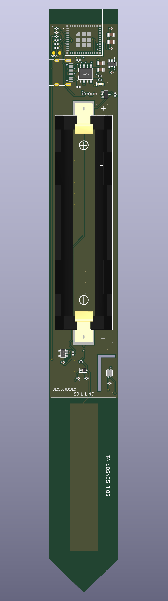

# Soil sensor v1

One board that is the whole sensor: ESP32-C6 (WiFi, ESPHome), an 18650 cell in
an on-board holder with USB-C charging and protection, a capacitive soil probe
made of copper under solder mask, and an SHTC3 for air temperature/humidity.
Fully assembled by JLCPCB; nothing to solder. Drop in a cell, plug in USB-C,
flash.



| | |
|---|---|
| Size | 25 x 222 mm, 2 layers, 1.6 mm, black, LeadFree HASL |
| Push into soil up to | the **SOIL LINE** silkscreen (70 mm of probe below it) |
| Battery | one 18650 (unprotected is fine: XB5353A protects it), + at the USB end |
| Charging | USB-C, ~500 mA (TP4056), red LED while charging |
| Readings | soil moisture %, air temperature, air humidity, battery V and % |
| Battery life | estimate 3-4 months per charge at one reading / 10 min (not measured) |

Design: [`docs/superpowers/specs/2026-11-16-soil-probe-board-design.md`](../../docs/superpowers/specs/2026-11-16-soil-probe-board-design.md).
Wiring for review: [`NETLIST.md`](NETLIST.md).

## Ordering at JLCPCB

Upload from [`jlcpcb/`](jlcpcb/):

1. `soil_sensor-gerbers.zip` as the Gerber file. Choose **black**, **LeadFree HASL**
   (OSP blocks Economic assembly), 1.6 mm.
2. PCB Assembly: **Economic**, **Top side**, quantity 2 (or 5).
3. `BOM-JLCPCB.csv` and `CPL-JLCPCB.csv`. Turn on **Confirm Parts Placement**
   so a JLC engineer checks rotations; the board was laid out by script and
   nobody has eyeballed every part's pin-1 marking in JLC's viewer yet.
4. Pick a Product Description (e.g. Research/Education/DIY -> DIY Hobby
   Circuit Board) or "Save to cart" silently does nothing.

Six parts carry JLC's $3.09 Extended fee (ESP32-C6-WROOM-1, XC6220, USB-C,
SHTC3, 18650 holder, XB5353A); everything else is Basic or Preferred.

## Firmware

```bash
cd firmware
cp secrets.example.yaml secrets.yaml   # fill in WiFi and keys
uvx esphome run soil-sensor.yaml
```

Calibrate once: read **Soil probe voltage** in Home Assistant with the probe in
dry air and in a glass of water, and put those two numbers into
`soil_dry_v` / `soil_wet_v` at the top of the YAML.

## Rebuilding the board files

Everything is generated; don't hand-edit the `.kicad_pcb`.

```bash
tools/fetch_parts.sh                    # footprints + Freerouting (needs Java 25+)
tools/route.sh                          # build, auto-route, stitch GND, DRC
tools/kpy gen/export_jlc.py             # gerbers, BOM, CPL into jlcpcb/
tools/kpy -m pytest tests -q            # 75 checks (netlist, placement, DRC, outputs)
```

Routing isn't reproducible run to run; the committed board is the one that was
checked.

## Not verified yet

Everything above is verified in software only (netlist checks, KiCad DRC,
ESPHome compile). Power-up, flashing, probe readings, charging and battery life
can only be checked once boards arrive.
